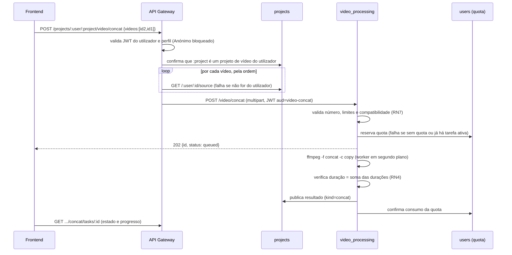

# UC-VID-005 — Concatenar Vídeos: relatório de implementação

**Data:** 2026-10-21 (atualizado a 2026-10-23, depois do merge com o UC3)

> **Nota sobre a estrutura:** depois do merge com o `main` (UC3), o UC5 segue a organização nova do serviço de vídeo. O código está em `use_cases/concat.py` e `use_cases/concat_integration.py` e usa `utils/` (`VideoTaskService`, `VideoError`, `profile_limits`, `register_video_service`). As alterações que o UC5 tinha feito ao `trim.py` e ao `trim_integration.py` deixaram de ser precisas, porque o `main` já trazia o equivalente. As referências a esses ficheiros nas secções abaixo descrevem o caminho seguido antes do merge; ver [`UC5-merge.md`](UC5-merge.md).
**Estado:** backend e frontend implementados. Backend testado de ponta a ponta; o frontend compila e está no ar, falta o teste manual no browser.

---

## 1. Resumo

O utilizador escolhe dois ou mais vídeos da sua biblioteca, define a ordem, e o sistema cria um novo vídeo com todos eles seguidos, sem alterar os originais. O processamento é assíncrono (fila, estados, progresso, cancelamento), consome uma operação da quota diária no perfil Gratuito e o resultado fica guardado no projeto a partir do qual a operação foi iniciada.

A concatenação é feita **sem recodificar** (cópia direta das streams com o *concat demuxer* do FFmpeg). Por isso é muito rápida (um vídeo de 73 s com 134 MB demorou menos de 1 s), mas exige que todos os vídeos tenham a mesma configuração técnica (RN7).

| Passo | Descrição | Estado |
|---|---|---|
| 1 | Núcleo: validação, compatibilidade e comando FFmpeg | Feito |
| 2 | Serviço com fila, rotas internas, quota e biblioteca | Feito (commit `d532a2e`) |
| — | Aceitar FPS variável no UC5 | Feito (por commitar) |
| 3 | Rotas públicas no gateway e biblioteca do utilizador | Feito (por commitar) |
| 4 | Interface (frontend) | Feito (por commitar; falta teste manual no browser) |

---

## 2. Arquitetura e fluxo

O UC5 segue o mesmo padrão do UC2 (recorte): o cliente nunca envia ficheiros, só identificadores; o gateway vai buscar os originais guardados e assina um token interno de curta duração.



Se algum passo depois da reserva falhar (processamento, verificação, publicação, cancelamento ou timeout), a tarefa fica **Falhada** ou **Cancelada**, o resultado é removido da biblioteca e a reserva de quota é libertada. Se o `users` ou o `projects` estiverem em baixo, a compensação fica registada e é repetida a cada 30 s e no arranque do serviço (mecanismo herdado do trim).

---

## 3. O que foi alterado

### 3.1 Ficheiros novos

| Ficheiro | Conteúdo |
|---|---|
| [`videoProcessing/use_cases/concat.py`](use_cases/concat.py) | Núcleo do UC5 (leitura com `ffprobe`, validações, compatibilidade, comando FFmpeg, verificação do resultado), `ConcatService` (fila e tarefas) e as rotas internas `/video/concat`. |
| [`videoProcessing/tests/test_concat.py`](tests/test_concat.py) | 20 testes automáticos (validação, serviço com hooks falsos, integração). |
| [`videoProcessing/tests/manual_concat.py`](tests/manual_concat.py) | Script para testar o serviço real sem gateway (faz o papel do gateway). |
| [`apiGateway/routes/videoConcat.js`](../apiGateway/routes/videoConcat.js) | Rotas públicas do UC5 e rota da biblioteca. |
| [`frontend/components/video/video-concat-editor.tsx`](../frontend/components/video/video-concat-editor.tsx) | Ecrã do UC5, no estilo do ecrã de recorte: biblioteca, sequência ordenável (subir, descer, remover; o mesmo vídeo pode repetir), estado e progresso com recuperação ao regressar, cancelamento, e lista de vídeos concatenados com pré-visualização e download. |

### 3.2 Alterações a código existente (trim e projects)

Para não duplicar código, o UC5 reaproveita a infraestrutura do UC2. Estas alterações tocam em ficheiros de outros elementos do grupo; nenhuma muda o comportamento do trim (os 20 testes do trim continuam a passar e as rotas do trim foram verificadas no gateway).

| Ficheiro | Alteração |
|---|---|
| `videoProcessing/trim.py` | `TrimService` ganhou o atributo `namespace = "trim"`; a pasta das tarefas passou a usá-lo. O `ConcatService` herda do `TrimService` com `namespace = "concat"`. |
| `videoProcessing/trim_integration.py` | Os hooks reais (quota e biblioteca) e a validação do JWT passaram para a função comum `_integration(audience, kind)`. Novo `register_concat()`. Ao publicar, é enviado o campo `kind`. |
| `videoProcessing/server.py` | Regista o concat ao lado do trim. |
| `videoProcessing/Dockerfile` | Copia `concat.py` para a imagem. |
| `projects/routes/videoResults.js` | Ao publicar, aceita `kind` (`trim` por omissão, ou `concat`) e copia o resultado da pasta certa. Nova rota interna `GET /:user/library`. |
| `apiGateway/routes/videoTrim.js` | `context()` recebe a audiência do JWT (`video-trim` por omissão); os helpers são exportados em `shared` para o `videoConcat.js`. |
| `apiGateway/routes/projects.js` | Monta o router `videoConcat`. |
| `frontend/lib/video.ts` | Tipos e funções da biblioteca e das rotas de concat; `VideoResult` ganhou `size` e `inputs` (opcionais). |
| `frontend/components/video/video-editor.tsx` | Botão "Concatenar com outros vídeos" que abre o ecrã do UC5. |

### 3.3 Rotas públicas (gateway)

Prefixo `/api-gateway/projects`. Todas exigem o JWT do utilizador.

| Método | Rota | Finalidade |
|---|---|---|
| GET | `/:user/:project/video/concat/library` | Lista os vídeos carregados pelo utilizador (um por projeto de vídeo), com os metadados e a assinatura de compatibilidade (RN7) de cada um. |
| POST | `/:user/:project/video/concat` | Pede a concatenação. Corpo: `{ "videos": [projectId, ...] }` pela ordem pretendida. O resultado fica em `:project`. |
| GET | `/:user/:project/video/concat/tasks` | Tarefas de concatenação do utilizador neste projeto. |
| GET | `/:user/:project/video/concat/tasks/:id` | Estado e progresso. |
| DELETE | `/:user/:project/video/concat/tasks/:id` | Cancelar (só Em fila ou A processar). |
| GET | `/:user/:project/video/concat/tasks/:id/download` | Descarregar o resultado. |

Depois de concluído, o resultado aparece também em `GET /:user/:project/video/results` (rota já existente do UC2).

**Exemplo de erro de compatibilidade** (422):

```json
{
  "code": "INCOMPATIBLE_VIDEOS",
  "error": "Os vídeos selecionados não são compatíveis para concatenação",
  "index": 1,
  "field": "width",
  "detail": "O vídeo 2 difere do primeiro em: largura."
}
```

Outros códigos: `TOO_FEW_VIDEOS`, `TOO_MANY_VIDEOS` (com `maxVideos` e `suggestPremium`), `VIDEO_TOO_LONG`, `VIDEO_TOO_LARGE` (com `index` e `suggestPremium`), `UNREADABLE_VIDEO`, `UNSUPPORTED_FORMAT`, `UNSUPPORTED_STREAMS`, `QUOTA_EXCEEDED`, `ACTIVE_TASK_LIMIT`, `PROCESSING_TIMEOUT`, `DURATION_MISMATCH`.

---

## 4. Decisões tomadas

| # | Decisão | Justificação |
|---|---|---|
| D1 | **Biblioteca** = o vídeo original de cada projeto de vídeo do utilizador. | Definição do grupo: "os vídeos que o utilizador adiciona à aplicação". |
| D2 | **O resultado fica no projeto a partir do qual a operação é iniciada** (`:project` na rota). Esse projeto tem de ser um projeto de vídeo do utilizador; é validado antes de processar. | O documento não define onde fica o resultado quando há vários vídeos de origem. **A confirmar com o grupo** (alternativa: criar um projeto novo). |
| D3 | **Sem recodificação** (`-c copy`). | CON-012 e DQ-015. |
| D4 | **FPS variável aceite no UC5**; a RN7 compara o FPS nominal (`r_frame_rate`). | Quase todos os vídeos de telemóvel têm FPS variável. Com cópia de streams, o timestamp de cada frame é mantido, por isso não há problema de sincronização. A RN4 (duração) continua a proteger o resultado. Verificado com um vídeo real de iPhone (60 fps nominais, 59,36 de média). |
| D5 | **Compatibilidade (RN7)** verificada campo a campo contra o primeiro vídeo: contentor; vídeo (codec, perfil, largura, altura, `pix_fmt`, `time_base`, FPS nominal); áudio (presente em todos ou em nenhum; codec, frequência, canais, `time_base`). O erro indica o vídeo e o campo. | Permite uma mensagem útil ("o vídeo 2 difere em: largura"). |
| D6 | Removido o `-xerror` do FFmpeg. | O AAC de cada ficheiro termina alguns ms depois do vídeo; na junção, o FFmpeg emite um aviso de timestamps que corrige sozinho. Com `-xerror` a concatenação falhava. A RN4 garante que um resultado errado não passa (diferença observada: 16–21 ms). |
| D7 | Limites por vídeo iguais ao trim: Gratuito 200 MB (decimais) e 5 min; Premium 2 GB e 30 min. | RN2 comum e COM-010/011. |
| D8 | O mesmo vídeo pode ser usado mais do que uma vez na mesma concatenação. | Não é proibido pelo documento e é útil (ex.: repetir uma introdução). |
| D9 | Os vídeos de entrada são **copiados** quando o pedido é aceite. | Garante RN5 (originais intactos). Consequência: apagar o original durante a tarefa não a afeta (ver secção 7, ponto 7). |

---

### 3.4 Metadados da biblioteca (CON-007)

O `video_processing` lê os metadados com `ffprobe` diretamente da rota interna `/source` do `projects`, por HTTPS. O `ffprobe` usa pedidos com Range e lê só o cabeçalho e o índice do vídeo, sem descarregar o ficheiro todo: o vídeo de iPhone de 67 MB foi lido em 0,22 s.

Cada vídeo da biblioteca traz duração, resolução, FPS nominal, formato, codecs, tamanho, presença de áudio e a **assinatura de compatibilidade**: a lista dos campos da RN7 pela ordem em que são comparados. A mesma função (`compatibility_signature`) é usada pela validação no servidor, por isso o aviso no ecrã e a recusa no servidor nunca divergem. Se um vídeo não puder ser lido, aparece com a mensagem de erro e não pode ser adicionado.

No ecrã, a sequência mostra os metadados de cada vídeo e a duração prevista do resultado. Se um vídeo não for compatível com o primeiro, a linha fica a vermelho, aparece a mensagem *"O vídeo N difere do primeiro em: …"* com os dois valores, e o botão Concatenar fica desativado.

## 5. Testes

### 5.1 Automáticos

```bash
docker run --rm -v "$PWD/videoProcessing:/app" -w /app picturas-video_processing \
  python -m unittest tests.test_concat tests.test_trim tests.test_trim_integration -v
```

Resultado: **44 testes, todos a passar** (24 do UC5 e 20 do UC2, para garantir que o trim não foi afetado). Os testes do UC5 passaram 5 vezes seguidas (sem instabilidade).

| Grupo | O que é testado |
|---|---|
| Validação | metadados e assinatura de compatibilidade; leitura por HTTP com credenciais (e recusa sem elas); incompatibilidade de áudio com o campo indicado; menos de 2 vídeos; limite 5/20 com `suggestPremium`; perfil Anónimo; incompatibilidade por resolução, áudio e FPS (com vídeo e campo indicados); vídeos sem áudio compatíveis entre si; ficheiro corrompido (com posição); escape de nomes com aspas. |
| Serviço (hooks falsos) | rota `/library` (e recusa do perfil Anónimo); fluxo completo pela ordem pedida, com publicação e consumo de quota; pedido inválido não cria tarefa nem reserva; quota recusada; Gratuito sem duas tarefas ativas; cancelamento liberta quota e apaga ficheiros; timeout mata o FFmpeg e liberta quota; falha na publicação marca Falhada e liberta; isolamento entre utilizadores e projetos; recuperação após reinício; **vídeos com FPS variável concatenados**. |
| Integração | só JWT com audiência `video-concat` é aceite; a publicação envia `kind: concat` e precede o consumo da quota. |

### 5.2 Manuais (com a aplicação real)

| Teste | Resultado |
|---|---|
| Dois vídeos H.264 gerados (3 s + 3 s), direto no serviço | Concluída, 6,0 s, publicada no projeto, quota consumida. |
| Vídeo real de iPhone (HEVC, 1206×2622, FPS variável) concatenado consigo próprio | Antes de D4: rejeitado (`VARIABLE_FPS`). Depois: concluída em < 1 s; 73,063 s para 73,047 s esperados. |
| Pelo gateway, com utilizador novo e dois projetos (clip 2 de 4 s + clip 1 de 3 s, resultado no projeto 1) | 202 → Concluída, 7 s, download 200 (546 KB), resultado listado em `video/results`, quota de 5 para 4. |
| Pelo gateway, casos de erro | 1 vídeo → "Selecione pelo menos dois vídeos"; vídeo inexistente ou de outro utilizador → "O vídeo 2 não foi encontrado na sua biblioteca"; sem quota → `QUOTA_EXCEEDED`; token de outro utilizador → recusado. |
| Rotas do trim depois das alterações | 200. |

Para repetir o teste manual sem gateway, ver as instruções no topo de [`manual_concat.py`](tests/manual_concat.py).

**Dados de teste criados na base de dados local:** utilizador `concat.teste.uc5@example.com` (palavra-passe `uc5-teste-123`) com os projetos "Clip 1" e "Clip 2"; dois resultados concatenados no projeto "Video" do utilizador "Teste 123" (que ficou sem quota no dia 2026-10-21).

---

## 6. Rastreabilidade (requisitos do UC5)

| Requisito | Onde | Estado |
|---|---|---|
| CON-001 mínimo de 2 vídeos | `validate_count` + gateway | Feito, testado |
| CON-002 mensagem "Selecione pelo menos dois vídeos" | idem | Feito, testado |
| CON-003 / CON-004 máximo 5 / 20 | `validate_count` (gateway limita a 20 para qualquer perfil) | Feito, testado |
| CON-005 ordem definida pelo utilizador | ordem do array `videos`; reordenação no ecrã; começa com o vídeo do projeto atual | Feito |
| CON-006 rejeitar incompatíveis (RN7) | `check_compatibility` | Feito, testado (com D4) |
| CON-007 apresentar metadados | `GET .../concat/library` (`inspect_source` + `describe`) e ecrã do UC5 | Feito, testado: duração, resolução, FPS, formato, codec, tamanho e áudio de cada vídeo; aviso de incompatibilidade antes de Processar |
| CON-008 duração = soma (±0,1 s por vídeo) | `verify_result` | Feito, testado |
| CON-009 resultado só disponível após sucesso | publicação no hook `complete`, depois da verificação | Feito, testado |
| CON-010 / CON-011 adicionar, remover, voltar à seleção | ecrã do UC5 (botão desativado com < 2 vídeos) e backend | Feito |
| CON-012 sem recodificação | `-c copy` | Feito |
| COM-001 Anónimo bloqueado | gateway e serviço (403) | Feito, testado |
| COM-010 / COM-011 / COM-014 / COM-015 limites por perfil e sugestão Premium | `validate_limits` | Feito, testado |
| COM-016 / COM-017 / COM-047–049 quota (reservar, consumir, libertar) | hooks + `users` | Feito, testado |
| COM-020 Gratuito com uma tarefa ativa | `users` (reserva atómica) | Feito, testado com hooks falsos |
| COM-025–030 identificador, Em fila, confirmação, progresso, estados | `ConcatService` | Feito (o intervalo de 5 s é do frontend) |
| COM-031–034 cancelamento | herdado do trim | Feito, testado |
| COM-036 / COM-037 limpeza e pasta por tarefa | `tasks/concat/<id>/` | Feito, testado |
| COM-038 timeout 30 min | herdado do trim | Feito, testado |
| COM-042 / COM-043 originais intactos, resultado novo na biblioteca | cópias das entradas; publicação no projeto | Feito, testado |
| COM-050 nomes sem substituir resultados anteriores | `<primeiro>_concatenado.<ext>`; guardado pelo ID da tarefa | Feito |
| COM-005 / COM-006 formatos aceites | ver secção 7, pontos 2 e 6 | Parcial (decisão D4) |
| COM-035 cancelar se o original for apagado | ver secção 7, ponto 7 | Não aplicável com D9 |

---

## 7. Alterações a fazer no documento (ERS / casos de uso)

1. **RN7 do UC5** — trocar "FPS constante" por "**o mesmo FPS nominal**". Texto proposto: *"Os critérios de compatibilidade são: mesmo formato de ficheiro, codec/configuração de vídeo, resolução, mesmo FPS nominal, formato de píxel e base temporal; todas as entradas sem áudio, ou todas com uma faixa compatível em codec/configuração, frequência, canais e base temporal."*
2. **REQ-VID-COM-005** — acrescentar a exceção: *"A rejeição de vídeos com FPS variável não se aplica ao UC-VID-005, que concatena sem recodificar."*
3. **Nova decisão de qualidade (DQ-016)** — *"O UC-VID-005 aceita vídeos com FPS variável. A concatenação copia as streams e mantém o timestamp de cada frame, pelo que não há perda de sincronização; a RN4 (duração) protege o resultado."* Requisitos relacionados: CON-006, CON-012, COM-005.
4. **Destino do resultado (decisão D2)** — no passo 10 do fluxo principal do UC5, trocar "Guarda o resultado como um novo vídeo na biblioteca" por *"Guarda o resultado como um novo vídeo no projeto a partir do qual a operação foi iniciada"* e acrescentar a definição de biblioteca nas assunções: *"A biblioteca do utilizador é constituída pelo vídeo original de cada um dos seus projetos de vídeo."*
5. **Questões em aberto Q1 e Q2 do UC5** — já estão respondidas pela RN7 e pela DQ-015; passar a "resolvidas" com referência a essas regras.
6. **REQ-VID-COM-006 (só H.264/VP9)** — atualmente **não é aplicado** no UC5 (um vídeo HEVC é aceite se todos os outros forem HEVC com a mesma configuração). Decidir: (a) aplicar a regra também no UC5, ou (b) acrescentar a mesma exceção do ponto 2, porque sem recodificação o codec não importa desde que seja igual em todos.
7. **REQ-VID-COM-035 (cancelar se o original for apagado)** — no UC5 os vídeos são copiados quando o pedido é aceite (D9), por isso apagar um original não afeta a tarefa. Propor: *"Não se aplica ao UC-VID-005: as entradas são copiadas na aceitação."*
8. **Exceção comum de timeout** — a linha refere o UC5 duas vezes ("UC-VID-001/005 passo 9" e "UC-VID-005 passo 10"); deixar só o passo 9.
9. **CON-003 / CON-004** — "sem limites agregados" está correto mas pouco claro; acrescentar que *"a duração total do resultado pode chegar à soma dos limites individuais (ex.: 5 × 5 min no Gratuito)"*.
10. **Gralhas** — CON-006: "aprovados ns RN7" → "aprovados na RN7"; o ID "REQ-VID-COM-04 99" deve ser "REQ-VID-COM-049".

---

## 8. Próximos passos

- Testar o ecrã no browser (seleção, ordem, erro de incompatibilidade, progresso, pré-visualização, download).
- Nota para o grupo: depois do merge do UC1 (commit `ca7619b`), o ecrã de recorte (`VideoTrimEditor`) deixou de estar ligado ao editor de vídeo; o botão "Recortar" mostra um formulário provisório. Não é do UC5, mas tem de ser corrigido.
- Ao reconstruir o frontend, reiniciar o nginx (`docker compose restart nginx`), senão dá 502.

**Pendentes de decisão do grupo:** D2 (projeto de destino) e o ponto 6 da secção 7 (codecs).
